# Modular Exponentiation: Timing Comparison

## Objective

Compare how four modular-exponentiation implementations behave under timing measurements, and see whether changing exponent bits changes the observed timing distribution.

## Context

Square-and-multiply computes `message^exponent mod modulus` by scanning exponent bits. Each bit requires a square; common implementations conditionally multiply by the message when the bit is 1. If the exponent is secret, differences in control flow, operation count, or memory access can create a timing side channel.

## What is compared

All variants calculate the same modular exponentiation, but select the multiplier differently. The implementations are in [`src/main.c`](src/main.c).

| Variant | Per-bit behavior | Potential leakage being examined |
| --- | --- | --- |
| **Original: branch-based** | Square; multiply by the message only when the exponent bit is 1. | Secret-dependent branch and number of multiplications. |
| **Dummy-multiply variant** | Square; then branch to multiply by the message (bit 1) or by 1 (bit 0). | Branch still depends on the bit; operands may have different costs. |
| **Secret-indexed table lookup** | Square; select `table[bit]` (message or 1); multiply. | Selection avoids an explicit branch but reads memory at a secret-dependent index. |
| **Mask-based conditional move** | Square; combine candidate MPI limbs with a mask; multiply by the selected value. | Avoids the secret-indexed table access in the selector. The rest of the MPI arithmetic is not constant-time. |

These are educational implementations, not production cryptography. The bundled legacy MPI library has variable-length arithmetic and other data-dependent behavior. No variant is claimed to be secure or constant-time.

## Experiment and result summary

The benchmark records 1,000 CPU-tick samples per implementation and scenario using C `clock()`. Debug uses GCC `-O0 -g`; Release uses `-O3`. Raw samples are archived in [`results/debug/`](results/debug/) and [`results/release/`](results/release/). Timing depends on hardware, compiler, and system load; compare distributions within a profile rather than treating absolute ticks as portable.

Four input scenarios are included:

1. Same message and exponent repeatedly — baseline variation/noise; does not test distinguishability between secrets.
2. Fixed exponent with `message = 1` — low-Hamming-weight but degenerate data; explores input-dependent cost, not exponent leakage.
3. Fixed exponent with `message = 0xFFFFFFFF` — higher-Hamming-weight data; likewise does not directly test exponent leakage.
4. Same generated message with low- and high-Hamming-weight exponents — the direct comparison for exponent-dependent timing in this experiment.

**Summary:** the original algorithm has secret-dependent multiplication work. The dummy-multiply variant equalizes the number of multiply calls but retains a secret-dependent branch. The table variant trades the branch for a secret-dependent memory index. The conditional-move experiment avoids that indexed access, but its use of variable-length MPI arithmetic prevents a constant-time claim. The plots show timing distributions for one set of runs, not proof of attack success or security.

## Graphs

### Debug (`-O0`)

**Scenario 1 — fixed message and exponent**

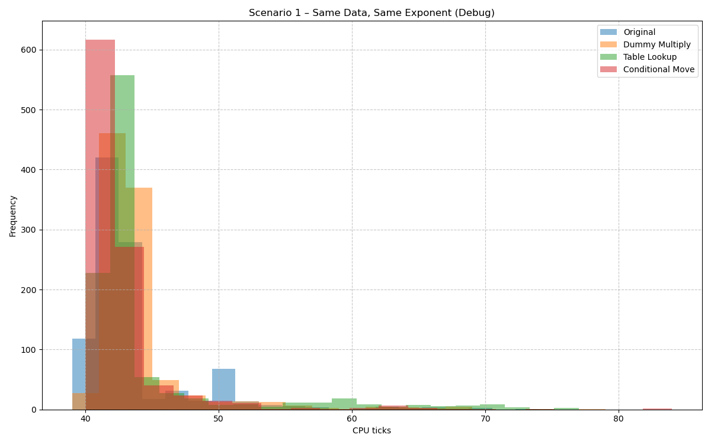

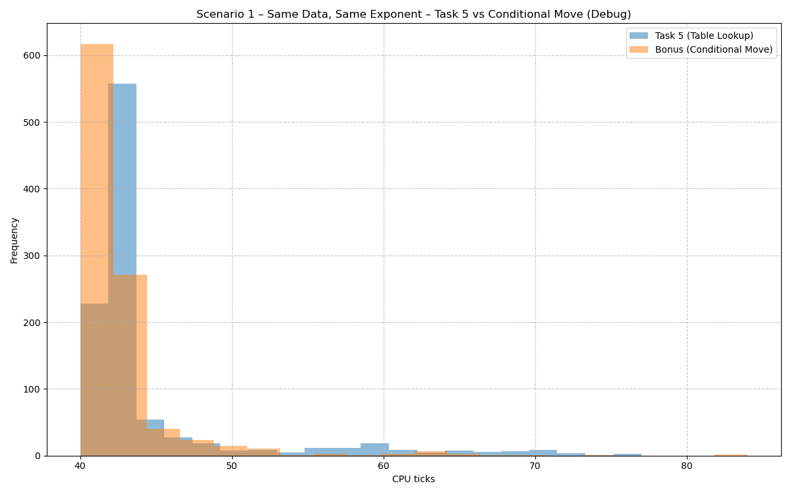

**Scenario 2 — low-Hamming-weight message (`message = 1`)**

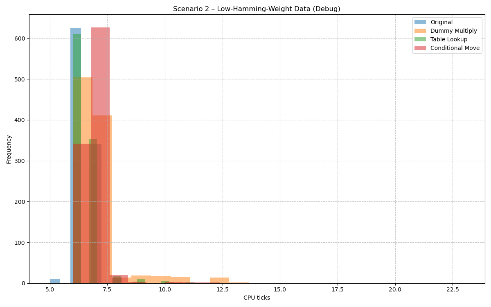

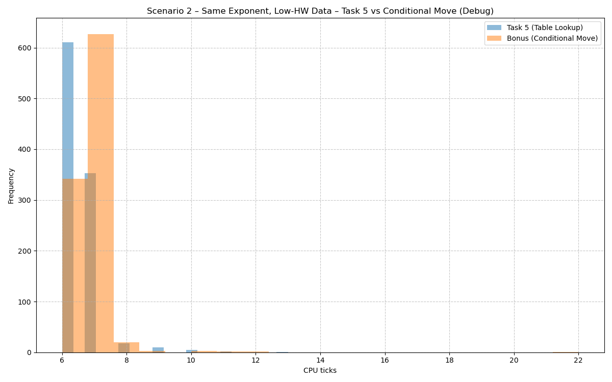

**Scenario 3 — higher-Hamming-weight message**

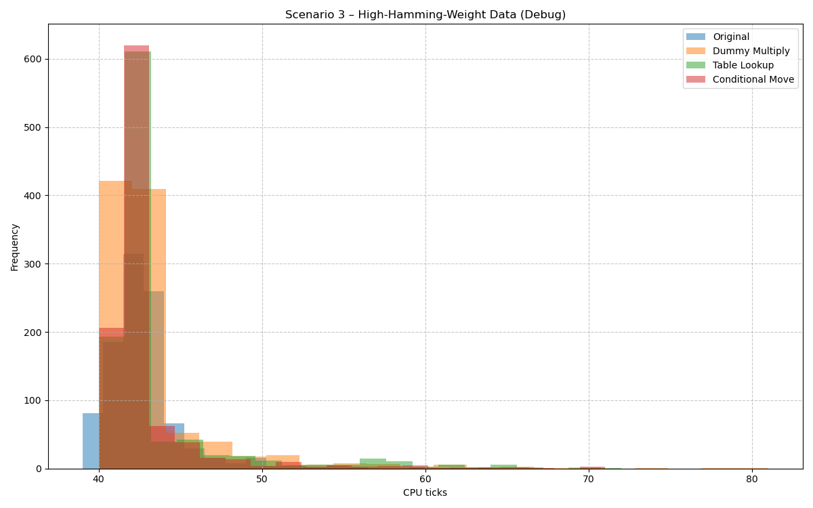

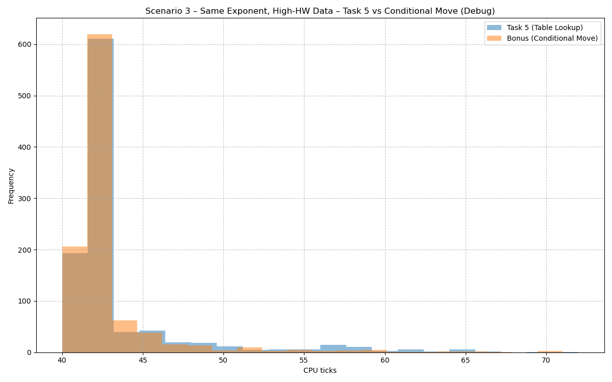

**Scenario 4 — low- vs. high-Hamming-weight exponent**

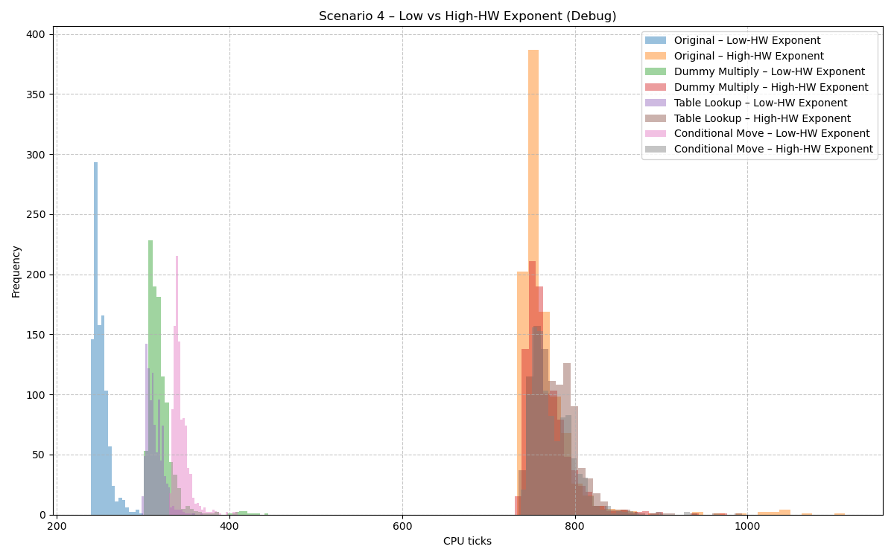

### Release (`-O3`)

**Scenario 1 — fixed message and exponent**

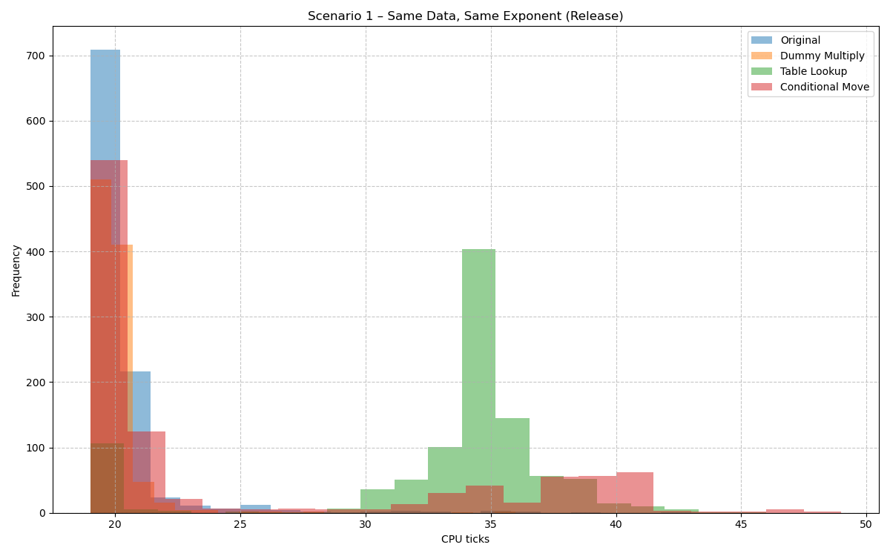

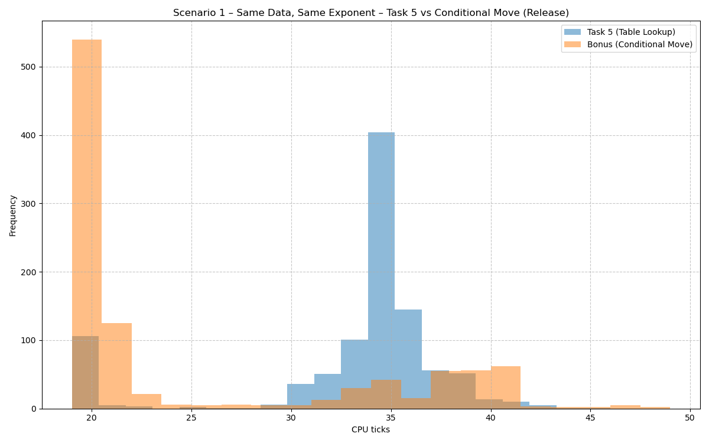

**Scenario 2 — low-Hamming-weight message (`message = 1`)**

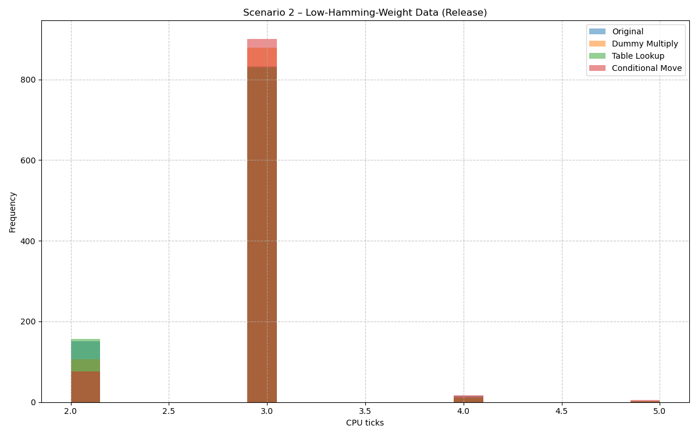

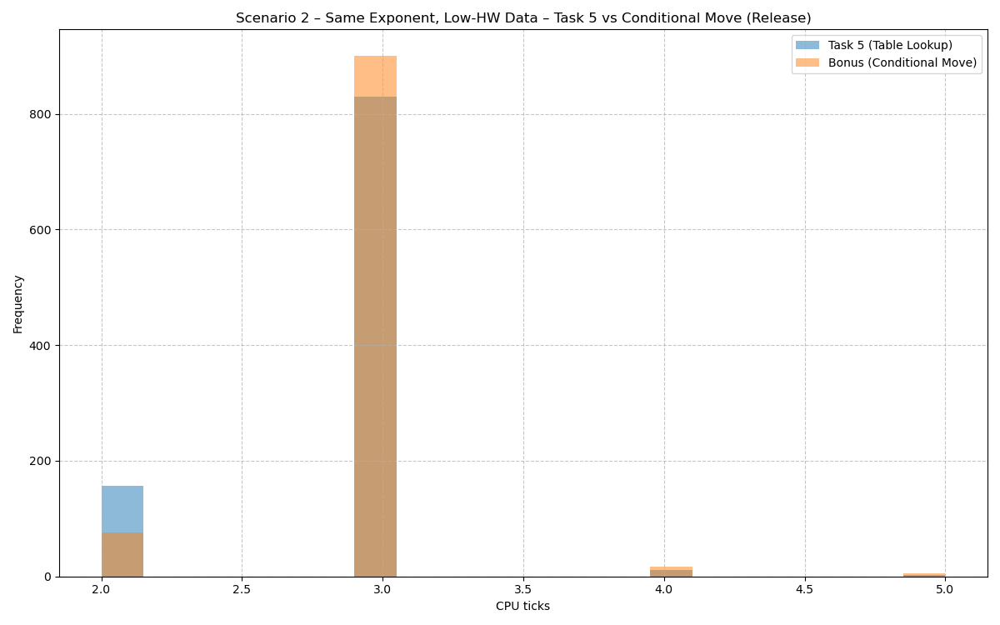

**Scenario 3 — higher-Hamming-weight message**

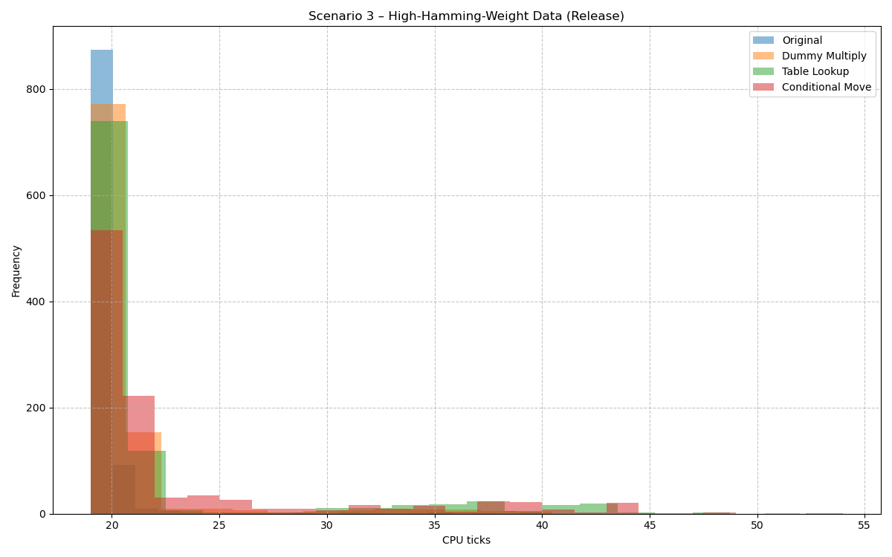

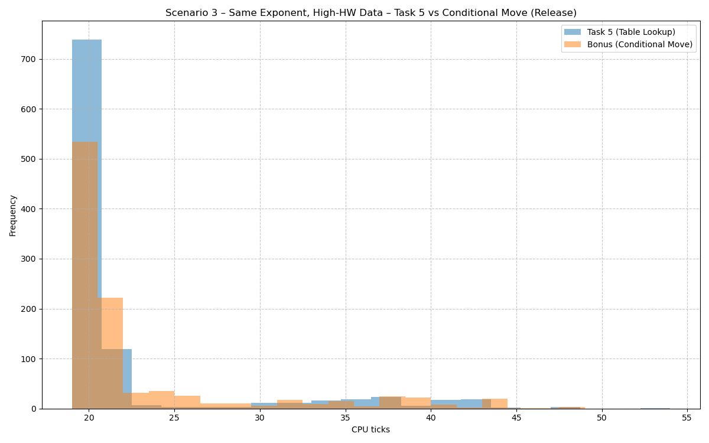

**Scenario 4 — low- vs. high-Hamming-weight exponent**

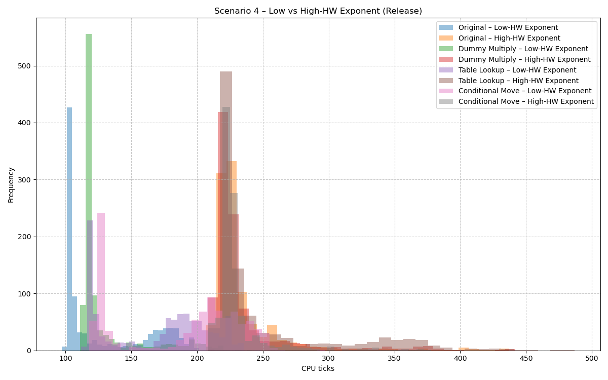

